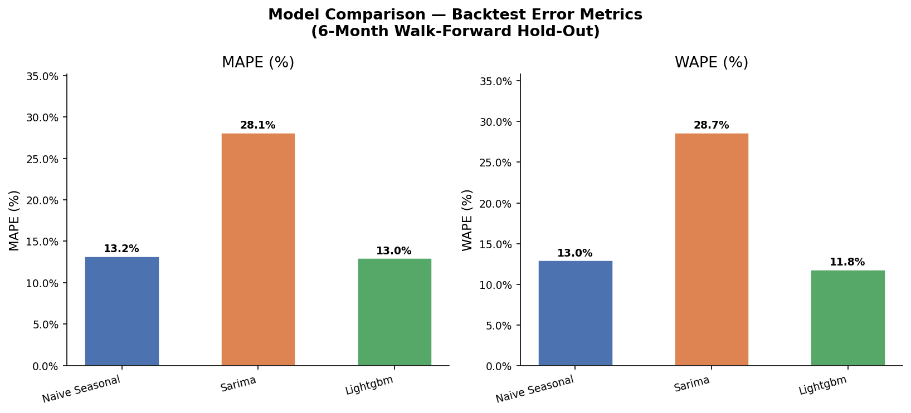
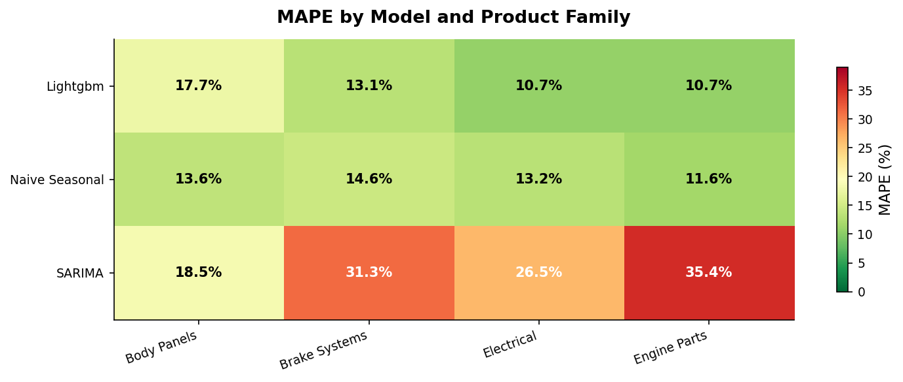
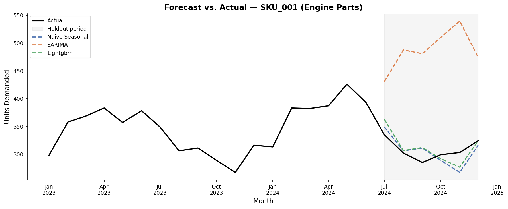

# Demand Forecasting Toolkit


A production-grade demand forecasting benchmark across **50 SKUs** and **4 automotive product families**, comparing a naive seasonal baseline, SARIMA, and LightGBM — with walk-forward backtesting, error metrics, and inventory dollar-impact estimation.

## Why This Exists

During my time as an Operations & Parts Analyst in the automotive aftermarket, I saw firsthand how fragile a pure "last year same period" assumption becomes once promotional events, trending demand, or seasonal phase shifts enter the picture. A miscalibrated forecast at the SKU level cascades directly into stockouts on fast-moving brake components or dead inventory on slow-moving body panels — both of which have measurable dollar consequences. This toolkit reproduces that challenge at scale: synthetic demand is generated with realistic trend, seasonality, promo-lift, and noise for 50 part numbers across Engine Parts, Brake Systems, Electrical, and Body Panels. Three forecasting approaches are benchmarked head-to-head on a held-out 6-month backtest window, and results are tied back to estimated overstock and stockout carrying costs.

---

## Results Summary

Backtest: last 6 months held out (Jul–Dec 2024), trained on Jan 2023–Jun 2024 (18 months).

| Model | MAPE | WAPE | RMSE |
|---|---|---|---|
| Naive Seasonal (baseline) | 13.23% | 12.98% | 40.30 |
| SARIMA (1,1,1)(1,0,0,12) | 28.14% | 28.68% | 106.67 |
| **LightGBM w/ lag features** | **13.00%** | **11.85%** | **36.34** |

**Key finding:** LightGBM edges out the naive seasonal baseline on all three metrics while also producing the lowest estimated inventory dollar impact. SARIMA underperforms on this short training window (18 months = 1.5 seasonal cycles), illustrating why statistical time-series models need longer history than ML approaches that can borrow signal across SKUs.

### MAPE & WAPE by Model



### MAPE Heatmap by Model and Product Family



### Forecast vs. Actual — SKU_001 (Engine Parts)



### Error Distribution (All SKUs)


### Estimated Inventory Dollar Impact


---

## Methodology

### Data Generation

`src/generate_demand.py` creates a reproducible (seed=42) 24-month panel of monthly unit demand for 50 SKUs across four product families. Each SKU has:

- A family-specific base demand level (Engine Parts ~320 u/mo, Brake Systems ~230, Electrical ~195, Body Panels ~150)
- A linear trend drawn from U(−2, +4) units/month
- An annual sine-wave seasonality with family-specific phase and amplitude U(20, 60)
- 1–3 promotional lift events per SKU (15–40% above base)
- Gaussian noise at 7% of base demand

### Backtest Setup

All three models follow the same **walk-forward** protocol:

- **Training window:** months 1–18 (Jan 2023 – Jun 2024)
- **Test window:** months 19–24 (Jul 2024 – Dec 2024)
- No data leakage: test actuals are never seen during model fitting

### Models

**1. Naive Seasonal Baseline** (`src/forecast_baseline.py`)  
Forecast for month *t* = actual demand at month *t*−12. Simple, interpretable, and the industry default for spare-parts planning.

**2. SARIMA** (`src/forecast_sarima.py`)  
`SARIMA(1,1,1)(1,0,0,12)` fit independently per SKU using `statsmodels`. The seasonal AR(1) at lag 12 captures the annual cycle without seasonal differencing — important here because 18 training months is only 1.5 cycles, making D=1 numerically unstable. Falls back to Holt-Winters Exponential Smoothing for any SKU where the SARIMA fit produces explosive forecasts.

**3. LightGBM with Lag/Rolling Features** (`src/forecast_ml.py`)  
A single global `LGBMRegressor` trained on all SKUs simultaneously, using:

| Feature | Description |
|---|---|
| `lag_1`, `lag_2`, `lag_3` | Demand 1–3 months prior |
| `lag_12` | Same-month prior year |
| `rolling_mean_3`, `rolling_std_3` | 3-month trailing statistics |
| `rolling_mean_6` | 6-month trailing mean |
| `month` | Calendar month (1–12) |
| `family_enc` | Label-encoded product family |

Cross-SKU training lets the model generalize seasonal patterns even with limited per-SKU history — a key advantage over per-series statistical models.

### Inventory Impact Estimation

Error is translated to dollar impact using assumed unit costs per family and two cost drivers:
- **Stockout cost:** 35% of unit cost per under-forecast unit (emergency sourcing / lost margin)
- **Overstock cost:** 20% of unit cost per over-forecast unit (carrying / obsolescence)

Results are in `reports/inventory_impact.csv`.

---

## How to Run

```bash
# 1. Clone the repository
git clone https://github.com/Gavand1969/demand-forecasting-toolkit.git
cd demand-forecasting-toolkit

# 2. Install dependencies
pip install -r requirements.txt

# 3. Run the full benchmark (generates data, forecasts, charts, and summary)
python src/benchmark.py
```

Outputs land in:
- `data/demand_panel.csv` — synthetic demand panel
- `reports/benchmark_summary.csv` — overall metric table
- `reports/inventory_impact.csv` — dollar impact by model and family
- `reports/charts/*.png` — all five charts

Individual scripts can also be run standalone:
```bash
python src/generate_demand.py
python src/forecast_baseline.py
python src/forecast_sarima.py
python src/forecast_ml.py
```

---

## What This Demonstrates

| Skill | Evidence |
|---|---|
| **Time-series forecasting** | Three-model benchmark with SARIMA and gradient boosting |
| **Feature engineering** | Lag, rolling mean/std, calendar, and cross-SKU features |
| **Walk-forward backtesting** | Proper hold-out without data leakage |
| **Error metric selection** | MAPE, WAPE, and RMSE — each with different failure-mode sensitivity |
| **Inventory analytics** | Dollar-impact translation of forecast error |
| **Data generation & reproducibility** | Seeded synthetic panel with realistic demand drivers |
| **Python data stack** | pandas, statsmodels, LightGBM, matplotlib |
| **Communication** | Benchmark charts and summary table suitable for business stakeholders |

---

## Project Structure

```
demand-forecasting-toolkit/
├── src/
│   ├── generate_demand.py      # Synthetic 24-month demand panel (50 SKUs)
│   ├── forecast_baseline.py    # Naive seasonal (same-period-last-year)
│   ├── forecast_sarima.py      # SARIMA(1,1,1)(1,0,0,12) per SKU
│   ├── forecast_ml.py          # LightGBM with lag/rolling features
│   └── benchmark.py            # Orchestration, metrics, and 5 charts
├── data/
│   └── demand_panel.csv        # Generated on first run
├── reports/
│   ├── benchmark_summary.csv
│   ├── inventory_impact.csv
│   └── charts/
│       ├── 01_model_comparison_mape.png
│       ├── 02_family_heatmap.png
│       ├── 03_forecast_vs_actual_sample.png
│       ├── 04_error_distribution.png
│       └── 05_inventory_impact.png
├── requirements.txt
├── LICENSE                     # MIT, Copyright 2026 Gavin Anderson
└── README.md
```

---

## License

MIT License — Copyright (c) 2026 Gavin Anderson. See [LICENSE](LICENSE) for details.
