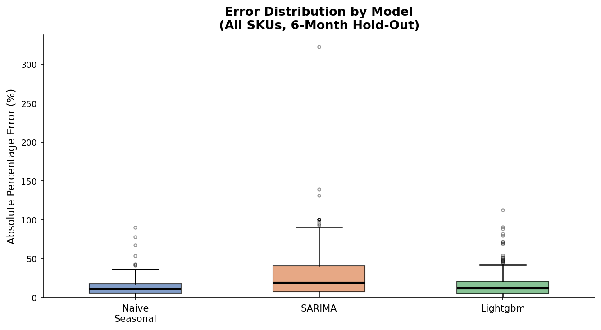
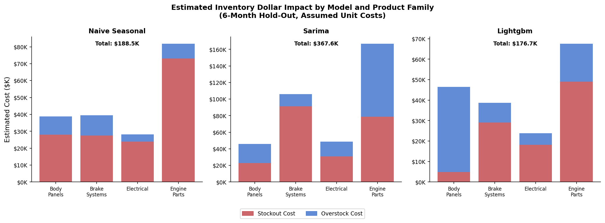

# Demand Forecasting Toolkit


A reproducible demand-forecasting benchmark across **50 SKUs** and **4 automotive product families**, comparing a naive seasonal baseline, SARIMA, and LightGBM under a **leakage-free walk-forward backtest**, with results translated into estimated inventory dollar impact.

## TL;DR for hiring managers

- **Problem framed in operations terms.** Synthetic demand is generated with trend, annual seasonality, promo lifts, and noise — the same dynamics that break a "last-year-same-month" forecast in spare-parts planning.
- **Three models, one honest comparison.** Naive seasonal, per-SKU SARIMA, and a global LightGBM with lag/rolling features, all evaluated on the same 6-month holdout.
- **Leakage-free protocol.** Multi-step ML forecasts are produced *recursively* — the model never sees a held-out actual when constructing its own next-step features. (This was a real fix during the audit; see [Methodology](#methodology).)
- **Tied back to dollars.** Forecast errors are converted to estimated stockout and overstock costs per family using documented assumptions, so the trade-off between under- and over-forecasting is visible.
- **Testable.** A `pytest` suite asserts metric formulas, reproducibility, and that the ML pipeline cannot peek at test actuals. CI runs the suite plus a smoke-test of the full benchmark on every push.

---

## Results summary

Backtest: last 6 months held out (Jul–Dec 2024), trained on Jan 2023 – Jun 2024 (18 months).

| Model | MAPE | WAPE | RMSE |
|---|---|---|---|
| Naive Seasonal (baseline) | 13.23% | 12.98% | 40.30 |
| SARIMA (1,1,1)(1,0,0,12) | 28.14% | 28.68% | 106.67 |
| LightGBM, recursive walk-forward | 15.59% | 13.42% | 40.80 |

**Read this honestly:** on this short 18-month training window, the naive seasonal baseline is genuinely hard to beat. LightGBM lands within ~0.5 pp of the baseline on WAPE/RMSE, while SARIMA underperforms because 18 months is only 1.5 seasonal cycles — exactly the kind of negative result you want to surface in a stakeholder review rather than hide. A longer history (3+ years) or a richer feature set (promo flags, price, cross-SKU trends) would be the next thing to try.

### MAPE & WAPE by model


### MAPE heatmap by model and product family


### Forecast vs. actual — SKU_001 (Engine Parts)


### Error distribution (all SKUs)


### Estimated inventory dollar impact


---

## Metrics — what each one tells you

For actual $a_i$ and forecast $f_i$ across $n$ SKU-months (rows with $a_i = 0$ are excluded so MAPE stays defined):

- **MAPE** — Mean Absolute Percentage Error: $\frac{1}{n}\sum_i \frac{|a_i - f_i|}{a_i}$. Easy to communicate; over-weights small-volume SKUs because a 10-unit miss on demand of 20 is the same 50% as a 100-unit miss on demand of 200.
- **WAPE** — Weighted Absolute Percentage Error: $\frac{\sum_i |a_i - f_i|}{\sum_i a_i}$. Volume-weighted, so it tracks total units mis-forecast across the catalog — usually the right summary metric for inventory decisions.
- **RMSE** — Root Mean Squared Error: $\sqrt{\frac{1}{n}\sum_i (a_i - f_i)^2}$. Penalizes large misses quadratically, so it surfaces tail-risk SKUs that MAPE can hide.

All three are reported because they fail differently. A model that is best on MAPE but worst on RMSE is one that handles the easy SKUs well but blows up on a few important ones.

---

## Methodology

### Data generation

`src/generate_demand.py` creates a reproducible (seed=42) 24-month panel of monthly unit demand for 50 SKUs across four product families. Each SKU has:

- A family-specific base demand level (Engine Parts ~320 u/mo, Brake Systems ~230, Electrical ~195, Body Panels ~150)
- A linear trend drawn from U(−2, +4) units/month
- An annual sine-wave seasonality with family-specific phase and amplitude U(20, 60)
- 1–3 promotional lift events per SKU (15–40% above base)
- Gaussian noise at 7% of base demand

> The panel is synthetic — the families, magnitudes, and shape were chosen to mirror what I worked with as an automotive parts analyst, not real proprietary data. The benchmark numbers above are a property of *this generator*, not of LightGBM in general.

### Backtest setup — walk-forward, no leakage

All three models share the same protocol:

- **Training window:** months 1–18 (Jan 2023 – Jun 2024)
- **Test window:** months 19–24 (Jul 2024 – Dec 2024)
- **Recursive multi-step forecasting for LightGBM:** at horizon $h>1$, lag and rolling features that fall inside the test window use the model's own prior forecasts, not the held-out actuals. The initial implementation built lag features off the full panel — see [audit/walk-forward-and-tests PR](#) — which silently leaked test actuals into the test-period features and inflated apparent MAPE by ~2.5 pp. The fix is asserted by `tests/test_no_leakage.py`.

### Models

**1. Naive seasonal baseline** (`src/forecast_baseline.py`). Forecast for month $t$ = actual demand at month $t-12$. The industry default for spare-parts planning, and the bar every other model must clear.

**2. SARIMA** (`src/forecast_sarima.py`). `SARIMA(1,1,1)(1,0,0,12)` fit independently per SKU using `statsmodels`. The seasonal AR(1) at lag 12 captures the annual cycle *without* seasonal differencing — important here because 18 training months is only 1.5 cycles, making $D=1$ numerically unstable. Falls back to Holt-Winters Exponential Smoothing for any SKU where the SARIMA fit produces explosive forecasts.

**3. LightGBM with lag/rolling features** (`src/forecast_ml.py`). A single global `LGBMRegressor` trained across all SKUs, using:

| Feature | Description |
|---|---|
| `lag_1`, `lag_2`, `lag_3` | Demand 1–3 months prior |
| `lag_12` | Same-month prior year |
| `rolling_mean_3`, `rolling_std_3` | 3-month trailing statistics |
| `rolling_mean_6` | 6-month trailing mean |
| `month` | Calendar month (1–12) |
| `family_enc` | Label-encoded product family |

Cross-SKU training lets the model borrow seasonal signal across the panel — a meaningful advantage over per-series statistical models when each series is short.

### Inventory impact estimation

Errors are translated to dollars using assumed unit costs per family and two cost drivers:

- **Stockout cost:** `35% × unit_cost × under_forecast_units` — proxy for emergency procurement premiums and lost margin on missed sales.
- **Overstock cost:** `20% × unit_cost × over_forecast_units` — proxy for carrying cost and obsolescence risk.

These percentages are illustrative defaults; in a real engagement they'd come from finance. Unit costs are coded in `src/benchmark.py:UNIT_COST` — change them to match your scenario. Results land in `reports/inventory_impact.csv`.

---

## How to run

```bash
# 1. Clone
git clone https://github.com/Gavand1969/demand-forecasting-toolkit.git
cd demand-forecasting-toolkit

# 2. Install
pip install -r requirements.txt

# 3. Run the full benchmark (data + 3 models + charts + summary)
python src/benchmark.py
#   or
make bench
```

Outputs land in:
- `data/demand_panel.csv` — synthetic demand panel
- `reports/benchmark_summary.csv` — overall metric table
- `reports/inventory_impact.csv` — dollar impact by model and family
- `reports/charts/*.png` — all five charts

Individual scripts can also be run standalone:
```bash
python src/generate_demand.py
python src/forecast_baseline.py
python src/forecast_sarima.py
python src/forecast_ml.py
```

### Tests

```bash
pip install -r requirements-dev.txt
pytest tests/ -v
#   or
make test
```

The `tests/` directory contains 8 tests covering:
- Reproducibility of the data generator under a fixed seed
- MAPE / WAPE / RMSE numerical correctness on hand-checked toy data
- Inventory-impact arithmetic against the documented formula
- **No-leakage guards** asserting that the ML pipeline cannot use test-period actuals as features

CI runs these tests plus a full benchmark smoke-test on every push and PR (`.github/workflows/ci.yml`).

---

## What this demonstrates

| Skill | Evidence |
|---|---|
| Time-series forecasting | Three-model benchmark with SARIMA and gradient boosting |
| Feature engineering | Lag, rolling mean/std, calendar, cross-SKU encoding |
| **Leakage-free backtesting** | Recursive walk-forward + tests that fail on regressions |
| Error metric selection | MAPE / WAPE / RMSE with documented trade-offs |
| Inventory analytics | Dollar-impact translation of forecast error |
| Reproducibility | Seeded synthetic panel + pinned dependencies + CI |
| Python data stack | pandas, statsmodels, LightGBM, matplotlib |
| Communication | Charts and metric tables aimed at non-technical stakeholders |

---

## Project structure

```
demand-forecasting-toolkit/
├── src/
│   ├── generate_demand.py      # Synthetic 24-month demand panel (50 SKUs)
│   ├── forecast_baseline.py    # Naive seasonal (same-period-last-year)
│   ├── forecast_sarima.py      # SARIMA(1,1,1)(1,0,0,12) per SKU
│   ├── forecast_ml.py          # LightGBM, recursive walk-forward
│   └── benchmark.py            # Orchestration, metrics, 5 charts
├── tests/                      # pytest suite (metrics, leakage, repro)
├── data/demand_panel.csv       # Generated on first run
├── reports/                    # CSVs + charts/
├── .github/workflows/ci.yml    # Tests + benchmark smoke-test
├── requirements.txt
├── requirements-dev.txt
├── Makefile
├── LICENSE                     # MIT, Copyright 2026 Gavin Anderson
└── README.md
```

---

## Known limits and next steps

- 24 months × 50 SKUs is a small panel by design — long enough to show seasonality, short enough that the benchmark runs end-to-end in under a minute. Real engagements would use 3+ years per SKU.
- The SARIMA configuration is fixed; per-SKU order selection (e.g. `pmdarima.auto_arima`) would likely close the gap to LightGBM.
- LightGBM features are deliberately minimal. Adding promo indicators, price, and exogenous calendar features would be the obvious next experiment.
- The dollar-impact percentages (35% stockout, 20% overstock) are illustrative — calibrate to your business before quoting numbers.

---

## License

MIT License — Copyright (c) 2026 Gavin Anderson. See [LICENSE](LICENSE) for details.
